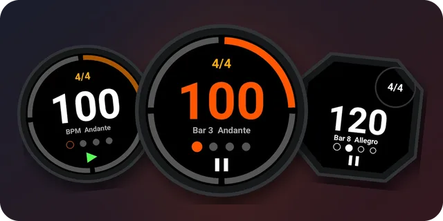
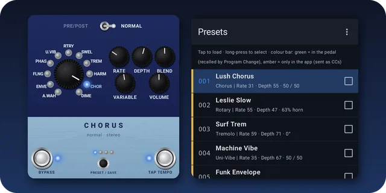
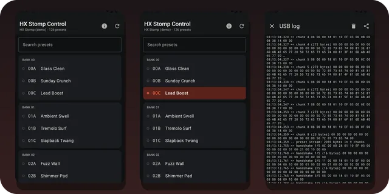
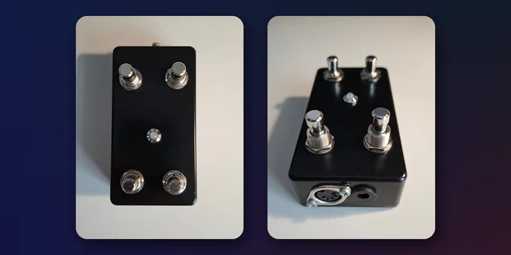
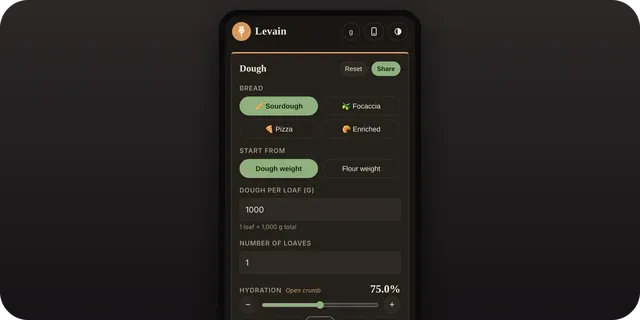
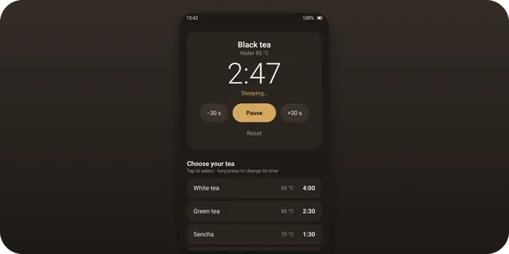
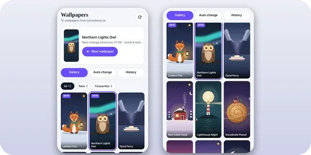
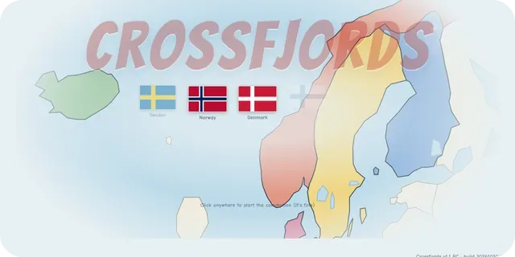
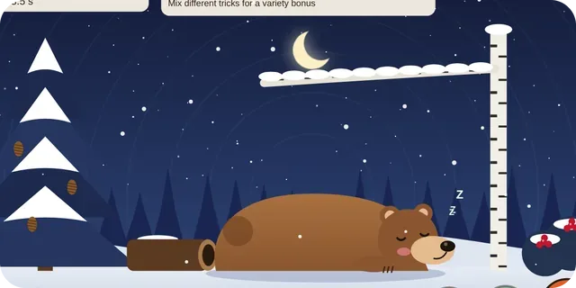

<a href="https://jonsolberg.se:8080">🌐 Website</a> &nbsp;·&nbsp; <a href="https://jonsolberg.se:8080/tools.html">🧰 Tools</a> &nbsp;·&nbsp; <a href="https://jonsolberg.se:8080/music.html">🎸 Music</a> &nbsp;·&nbsp; <a href="https://jonsolberg.se:8080/games.html">🎮 Games</a> &nbsp;·&nbsp; <a href="https://ko-fi.com/jonsolberg">🍺 Buy me a beer</a> &nbsp;·&nbsp; <a href="mailto:github@jonsolberg.se">✉️ github@jonsolberg.se</a>

<i>I make small, free apps and games: tools for musicians, a bread calculator, a tea timer, wallpapers and a few games you can play in the browser. The apps are open source under GPL v3.</i>

<h2 align="center">🎸 For musicians</h2>

<table>
<tr>
<td width="50%" valign="top">

<h3>🎸 <a href="https://github.com/jonsolberg/plektrum">Plektrum</a></h3>
Android · <a href="https://github.com/jonsolberg/plektrum/releases/tag/v1.31">v1.31</a> 
Chords, tuner, scales and progressions for every string instrument. 
<a href="https://jonsolberg.se:8080/Software/Plektrum.apk">Android app</a> · <a href="https://github.com/jonsolberg/plektrum">Source</a>
</td>
<td width="50%" valign="top">

<h3>⌚ <a href="https://github.com/jonsolberg/tactus">Tactus</a></h3>
Garmin Connect IQ · <a href="https://github.com/jonsolberg/tactus/releases/tag/v1.0.0">v1.0.0</a> 
A metronome you feel: it buzzes the beat on your Garmin watch. 
<a href="https://github.com/jonsolberg/tactus/releases/latest/download/Tactus-fenix7.prg">fēnix 7 app</a> · <a href="https://github.com/jonsolberg/tactus/blob/main/docs/INSTALL.md">Install guide</a> · <a href="https://github.com/jonsolberg/tactus">Source</a>
</td>
</tr>
<tr>
<td width="50%" valign="top">

<h3>🎛️ <a href="https://github.com/jonsolberg/strymoniridiumcontrol">Iridium Control</a></h3>
Android · <a href="https://github.com/jonsolberg/strymoniridiumcontrol/releases/tag/v1.1.6">v1.1.6</a> 
Editor and 300-preset library for the Strymon Iridium. 
<a href="https://jonsolberg.se:8080/Software/IridiumControl.apk">Android app</a> · <a href="https://github.com/jonsolberg/strymoniridiumcontrol">Source</a>
</td>
<td width="50%" valign="top">

<h3>🌀 <a href="https://github.com/jonsolberg/wamplerterraformcontrol">Terraform Control</a></h3>
Android · <a href="https://github.com/jonsolberg/wamplerterraformcontrol/releases/tag/v1.0.3">v1.0.3</a> 
Editor and presets for the Wampler Terraform pedal. 
<a href="https://jonsolberg.se:8080/Software/TerraformControl.apk">Android app</a> · <a href="https://github.com/jonsolberg/wamplerterraformcontrol">Source</a>
</td>
</tr>
<tr>
<td width="50%" valign="top">

<h3>🎚️ <a href="https://github.com/jonsolberg/hxstompforandroid">HX Stomp Control</a></h3>
Android · experimental · <a href="https://github.com/jonsolberg/hxstompforandroid/releases/tag/v0.1.0">v0.1.0</a> 
An early Android HX Edit for the Line 6 HX Stomp. 
<a href="https://github.com/jonsolberg/hxstompforandroid/releases/latest/download/HXStompControl.apk">Android app (test)</a> · <a href="https://github.com/jonsolberg/hxstompforandroid">Source</a>
</td>
<td width="50%" valign="top">

<h3>🎹 <a href="https://github.com/jonsolberg/midi_muppet_multi_4btn">MIDI Muppet 4btn</a></h3>
Arduino · DIY 
DIY four button MIDI foot switch you set up in the browser – HX Stomp, RC-500, Terraform. 
<a href="https://jonsolberg.se:8080/MidiMuppet/">Web editor</a> · <a href="https://github.com/jonsolberg/midi_muppet_multi_4btn#hardware">Build guide</a> · <a href="https://github.com/jonsolberg/midi_muppet_multi_4btn">Source</a>
</td>
</tr>
</table>

<h2 align="center">🍞 Everyday tools</h2>

<table>
<tr>
<td width="50%" valign="top">

<h3>🍞 <a href="https://github.com/jonsolberg/levain">Levain</a></h3>
Android · <a href="https://github.com/jonsolberg/levain/releases/tag/v1.1">v1.1</a> 
Bread calculator with baker's percentages and step timers. 
<a href="https://jonsolberg.se:8080/Software/Levain.apk">Android app</a> · <a href="https://github.com/jonsolberg/levain">Source</a>
</td>
<td width="50%" valign="top">

<h3>🍵 <a href="https://github.com/jonsolberg/tea-timer">Tea Timer</a></h3>
Android · <a href="https://github.com/jonsolberg/tea-timer/releases/tag/v1.2">v1.2</a> 
Steep times and temperatures for eleven kinds of tea. 
<a href="https://jonsolberg.se:8080/Software/TeaTimer.apk">Android app</a> · <a href="https://github.com/jonsolberg/tea-timer">Source</a>
</td>
</tr>
<tr>
<td width="50%" valign="top">

<h3>🖼️ <a href="https://github.com/jonsolberg/wallpaper">Wallpapers</a></h3>
Android · Windows · Linux · <a href="https://github.com/jonsolberg/wallpaper/releases/tag/android-1.1-linux-1.3-windows-1.8">android-1.1-linux-1.3-windows-1.8</a> 
A fresh wallpaper from jonsolberg.se, every day. 
<a href="https://jonsolberg.se:8080/Software/jonsolberg-wallpapers-1.0.apk">Android</a> · <a href="https://jonsolberg.se:8080/Software/Wallpapers-Windows.exe">Windows</a> · <a href="https://jonsolberg.se:8080/Wallpapers/">Browse wallpapers</a> · <a href="https://github.com/jonsolberg/wallpaper">Source</a>
</td>
<td width="50%"></td>
</tr>
</table>

<h2 align="center">🎮 Games</h2>

Play them in the browser on jonsolberg.se, or install the Android versions.

<table>
<tr>
<td width="50%" valign="top">

<h3>🗺️ <a href="https://jonsolberg.se:8080/Games/Crossroads/">Crossroads</a></h3>
Browser · Android 
Diplomacy where every ally has a price. 
<a href="https://jonsolberg.se:8080/Games/Crossroads/">Play</a> · <a href="https://jonsolberg.se:8080/Games/Crossroads/Android/Crossroads.apk">Android app</a>
</td>
<td width="50%" valign="top">

<h3>⛵ <a href="https://jonsolberg.se:8080/Games/Crossfjords/">Crossfjords</a></h3>
Browser 
A Nordic comedy of very polite wars. 
<a href="https://jonsolberg.se:8080/Games/Crossfjords/">Play</a>
</td>
</tr>
<tr>
<td width="50%" valign="top">

<h3>🐻 <a href="https://jonsolberg.se:8080/Games/WakeTheBear/">Wake the Bear</a></h3>
Browser 
A small robin, a sleeping bear and a lot of ideas. 
<a href="https://jonsolberg.se:8080/Games/WakeTheBear/">Play</a>
</td>
<td width="50%" valign="top">

<h3>🎅 <a href="https://jonsolberg.se:8080/Games/NaughtyListCaper/">The Naughty List Caper</a></h3>
Browser · Android 
Point-and-click: get Barnaby off Santa's Naughty List. 
<a href="https://jonsolberg.se:8080/Games/NaughtyListCaper/">Play</a> · <a href="https://jonsolberg.se:8080/Games/NaughtyListCaper/Android/NaughtyListCaper.apk">Android app</a>
</td>
</tr>
</table>

This page updates itself every day from <a href="https://github.com/jonsolberg/jonsolberg/blob/main/projects.toml">projects.toml</a> and my public repositories · All my code is licensed under GPL v3

