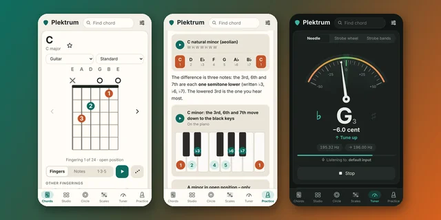
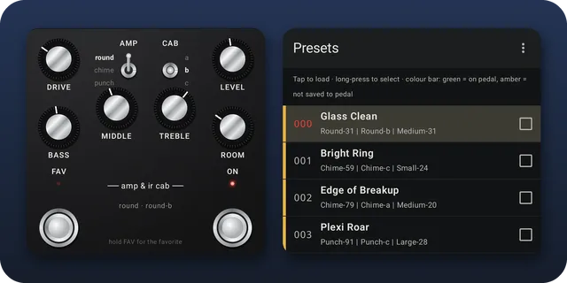
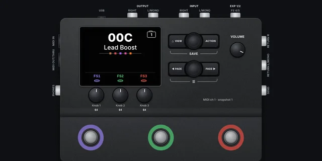
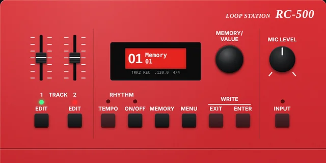
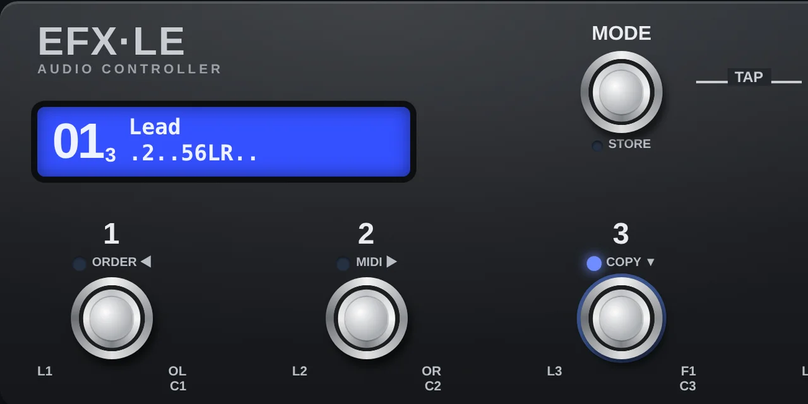
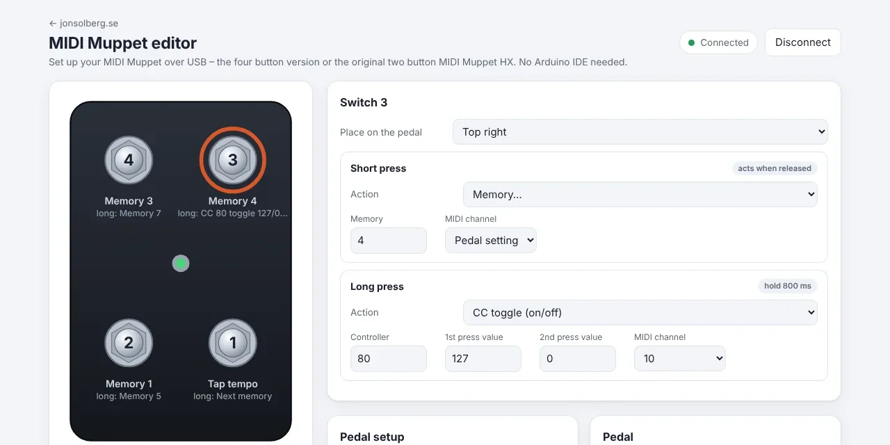

<a href="https://jonsolberg.se:8080">🌐 Website</a> &nbsp;·&nbsp; <a href="https://jonsolberg.se:8080/tools.html">🧰 Tools</a> &nbsp;·&nbsp; <a href="https://jonsolberg.se:8080/music.html">🎸 Music</a> &nbsp;·&nbsp; <a href="https://jonsolberg.se:8080/games.html">🎮 Games</a> &nbsp;·&nbsp; <a href="https://ko-fi.com/jonsolberg">❤️ Support me</a> &nbsp;·&nbsp; <a href="mailto:github@jonsolberg.se">✉️ github@jonsolberg.se</a>

<i>I make free apps for musicians – pedal editors, a chord and scale toolbox, a metronome for your watch – plus a few everyday helpers and some games you can play in the browser. The apps are open source under GPL v3.</i>

By day I work with IT strategy, requirements and information architecture – see my <a href="https://jonsolberg.se:8080">portfolio and CV</a>.

<h2 align="center">🎸 For musicians</h2>

<table>
<tr>
<td width="50%" valign="top">

<h3>🎸 <a href="https://github.com/jonsolberg/plektrum">Plektrum</a></h3>
Android · <a href="https://github.com/jonsolberg/plektrum/releases/tag/v1.38">v1.38</a> 
Chords, tuner, scales and progressions for every string instrument. 
<a href="https://github.com/jonsolberg/plektrum/releases/latest/download/Plektrum.apk">Android app</a> · <a href="https://github.com/jonsolberg/plektrum">Source</a>
</td>
<td width="50%" valign="top">

<h3>⌚ <a href="https://github.com/jonsolberg/tactus">Tactus</a></h3>
Garmin Connect IQ · <a href="https://github.com/jonsolberg/tactus/releases/tag/v1.0.0">v1.0.0</a> 
A metronome you feel: it buzzes the beat on your Garmin watch. 
<a href="https://apps.garmin.com/apps/4fb22149-d95c-454f-a482-f644301c5345">Connect IQ Store</a> · <a href="https://github.com/jonsolberg/tactus">Source</a>
</td>
</tr>
<tr>
<td width="50%" valign="top">

<h3>🎛️ <a href="https://github.com/jonsolberg/strymoniridiumcontrol">Iridium Control</a></h3>
Web · Android · <a href="https://github.com/jonsolberg/strymoniridiumcontrol/releases/tag/v1.1.9">v1.1.9</a> 
Editor and 300-preset library for the Strymon Iridium. 
<a href="https://jonsolberg.github.io/strymoniridiumcontrol/">Web editor</a> · <a href="https://github.com/jonsolberg/strymoniridiumcontrol/releases/latest/download/IridiumControl.apk">Android app</a> · <a href="https://github.com/jonsolberg/strymoniridiumcontrol">Source</a>
</td>
<td width="50%" valign="top">

<h3>🌀 <a href="https://github.com/jonsolberg/wamplerterraformcontrol">Terraform Control</a></h3>
Web · Android · <a href="https://github.com/jonsolberg/wamplerterraformcontrol/releases/tag/v1.0.6">v1.0.6</a> 
Editor and presets for the Wampler Terraform pedal. 
<a href="https://jonsolberg.github.io/wamplerterraformcontrol/">Web editor</a> · <a href="https://github.com/jonsolberg/wamplerterraformcontrol/releases/latest/download/TerraformControl.apk">Android app</a> · <a href="https://github.com/jonsolberg/wamplerterraformcontrol">Source</a>
</td>
</tr>
<tr>
<td width="50%" valign="top">

<h3>🎚️ <a href="https://github.com/jonsolberg/hxstompcontrol">HX Stomp Control</a></h3>
Web · Android · experimental · <a href="https://github.com/jonsolberg/hxstompcontrol/releases/tag/v0.2.5">v0.2.5</a> 
Play and edit the Line 6 HX Stomp from your phone or browser. 
<a href="https://jonsolberg.github.io/hxstompcontrol/">Web editor</a> · <a href="https://github.com/jonsolberg/hxstompcontrol/releases/latest/download/HXStompControl.apk">Android app (test)</a> · <a href="https://github.com/jonsolberg/hxstompcontrol">Source</a>
</td>
<td width="50%" valign="top">

<h3>🔁 <a href="https://github.com/jonsolberg/rc500editor">RC-500 Editor</a></h3>
Web · Android · experimental · <a href="https://github.com/jonsolberg/rc500editor/releases/tag/v2.50">v2.50</a> 
Editor and live control for the BOSS RC-500 looper over its USB port. 
<a href="https://jonsolberg.github.io/rc500editor/">Web editor</a> · <a href="https://github.com/jonsolberg/rc500editor/releases/latest/download/RC500Editor.apk">Android app</a> · <a href="https://github.com/jonsolberg/rc500editor">Source</a>
</td>
</tr>
<tr>
<td width="50%" valign="top">

<h3>🔀 <a href="https://github.com/jonsolberg/efx-le-loop-swither-editor">EFX-LE Editor</a></h3>
Web · <a href="https://github.com/jonsolberg/efx-le-loop-swither-editor/releases/tag/v1.0">v1.0</a> 
Editor and live control for the Musicom Lab EFX-LE loop switcher. 
<a href="https://jonsolberg.github.io/efx-le-loop-swither-editor/">Web editor</a> · <a href="https://github.com/jonsolberg/efx-le-loop-swither-editor">Source</a>
</td>
<td width="50%" valign="top">

<h3>🎹 <a href="https://github.com/jonsolberg/midi_muppet_max">MIDI Muppet Max</a></h3>
Arduino · DIY · Android · <a href="https://github.com/jonsolberg/midi_muppet_max/releases/tag/v2.1.1">v2.1.1</a> 
DIY MIDI foot switch you set up in the browser: pick your pedal, pick a command for every switch. 
<a href="https://jonsolberg.github.io/midi_muppet_max/">Web editor</a> · <a href="https://github.com/jonsolberg/midi_muppet_max/releases/latest/download/MidiMuppetMax.apk">Android app</a> · <a href="https://github.com/jonsolberg/midi_muppet_max#hardware">Build guide</a> · <a href="https://github.com/jonsolberg/midi_muppet_max">Source</a>
</td>
</tr>
</table>

<h2 align="center">🍞 Everyday tools</h2>

<table>
<tr>
<td width="50%" valign="top">

<h3>🍞 <a href="https://github.com/jonsolberg/levain">Levain</a></h3>
Android · <a href="https://github.com/jonsolberg/levain/releases/tag/v1.6">v1.6</a> 
Bread calculator with baker's percentages and step timers. 
<a href="https://github.com/jonsolberg/levain/releases/latest/download/Levain.apk">Android app</a> · <a href="https://github.com/jonsolberg/levain">Source</a>
</td>
<td width="50%" valign="top">

<h3>🍵 <a href="https://github.com/jonsolberg/tea-timer">Tea Timer</a></h3>
Android · <a href="https://github.com/jonsolberg/tea-timer/releases/tag/v1.5">v1.5</a> 
Steep times and temperatures for eleven kinds of tea. 
<a href="https://github.com/jonsolberg/tea-timer/releases/latest/download/TeaTimer.apk">Android app</a> · <a href="https://github.com/jonsolberg/tea-timer">Source</a>
</td>
</tr>
<tr>
<td width="50%" valign="top">

<h3>🖼️ <a href="https://github.com/jonsolberg/wallpaper">Wallpapers</a></h3>
<a href="https://github.com/jonsolberg/wallpaper/releases/tag/android-1.5-linux-1.6-windows-1.11">Android 1.5 · Linux 1.6 · Windows 1.11</a> 
A fresh wallpaper from jonsolberg.se, every day. 
<a href="https://github.com/jonsolberg/wallpaper/releases/latest/download/Wallpapers.apk">Android</a> · <a href="https://github.com/jonsolberg/wallpaper/releases/latest/download/Wallpapers-Windows.exe">Windows</a> · <a href="https://github.com/jonsolberg/wallpaper/releases/latest/download/jonsolberg-wallpapers_all.deb">Linux</a> · <a href="https://jonsolberg.se:8080/Wallpapers/">Browse wallpapers</a> · <a href="https://github.com/jonsolberg/wallpaper">Source</a>
</td>
<td width="50%"></td>
</tr>
</table>

<h2 align="center">🎮 Games</h2>

Play them in the browser on jonsolberg.se, or install the Android versions.

<table>
<tr>
<td width="50%" valign="top">

<h3>🐻 <a href="https://jonsolberg.se:8080/Games/WakeTheBear/">Wake the Bear</a></h3>
Browser 
A small robin, a sleeping bear and a lot of ideas. 
<a href="https://jonsolberg.se:8080/Games/WakeTheBear/">Play</a>
</td>
<td width="50%" valign="top">

<h3>🎅 <a href="https://jonsolberg.se:8080/Games/NaughtyListCaper/">The Naughty List Caper</a></h3>
Browser · Android 
Point-and-click: get Barnaby off Santa's Naughty List. 
<a href="https://jonsolberg.se:8080/Games/NaughtyListCaper/">Play</a> · <a href="https://jonsolberg.se:8080/Games/NaughtyListCaper/Android/NaughtyListCaper.apk">Android app</a>
</td>
</tr>
</table>

<h2 align="center">✨ New & other</h2>

<table>
<tr>
<td width="50%" valign="top">
<h3>✨ <a href="https://github.com/jonsolberg/naughtylistcaper">naughtylistcaper</a></h3>
A point-and-click Christmas adventure in the old pirate-island style. Bad boy Barnaby Sneer heads for the North Pole to get his name off Santa's Naughty List. 
<a href="https://jonsolberg.se:8080/Games/NaughtyListCaper/">Website</a> · <a href="https://github.com/jonsolberg/naughtylistcaper">Source</a>
</td>
<td width="50%"></td>
</tr>
</table>

This page updates itself every day from <a href="https://github.com/jonsolberg/jonsolberg/blob/main/projects.toml">projects.toml</a> and my public repositories · All my code is licensed under GPL v3

